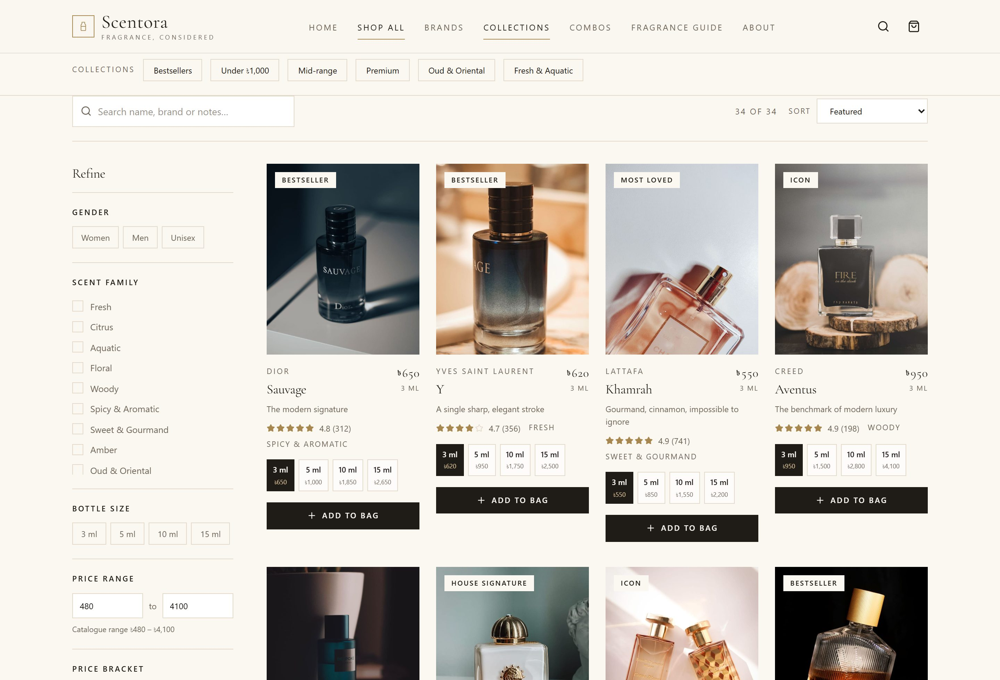
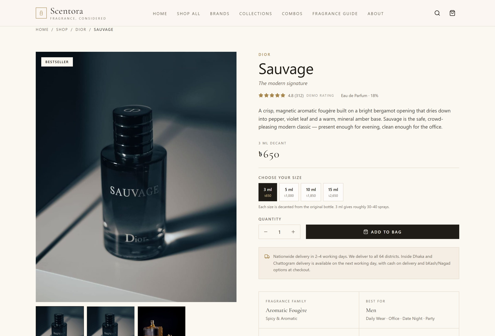
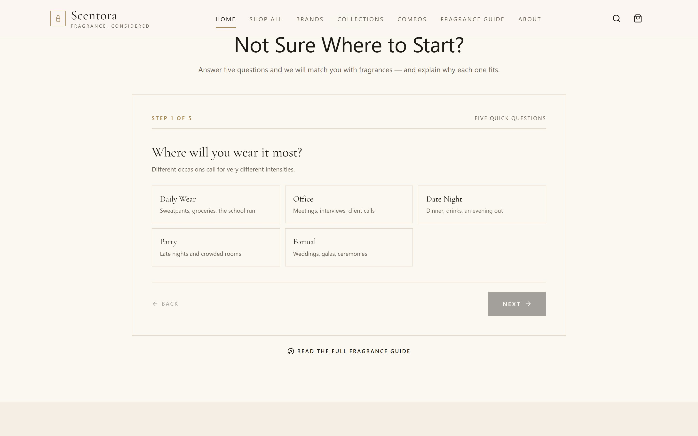
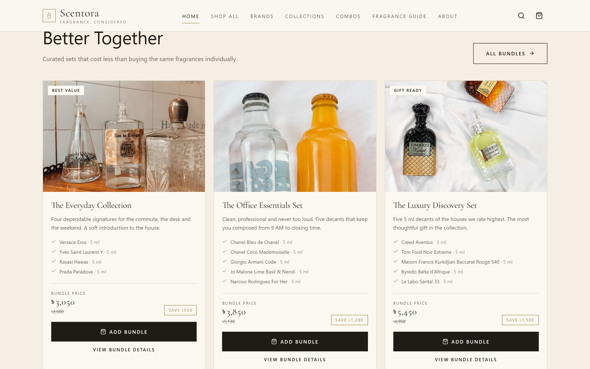
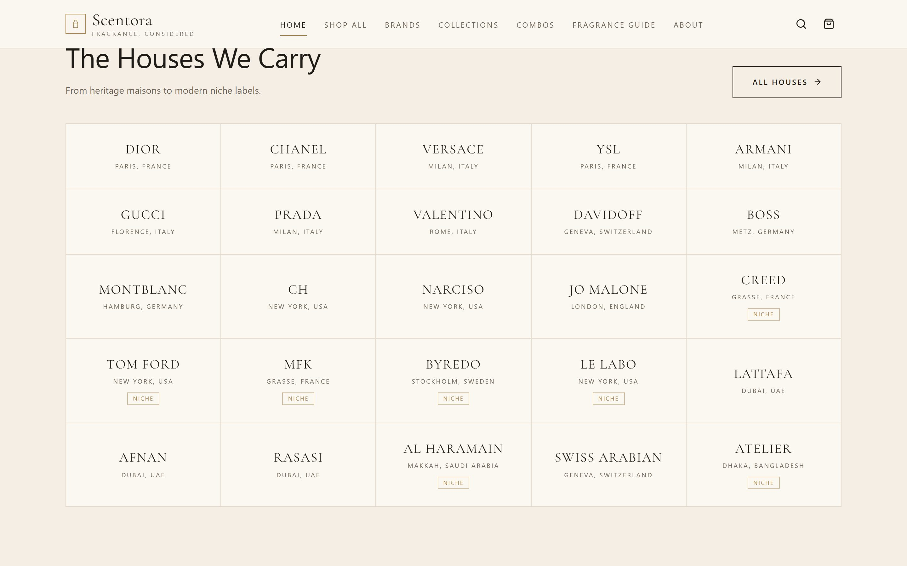
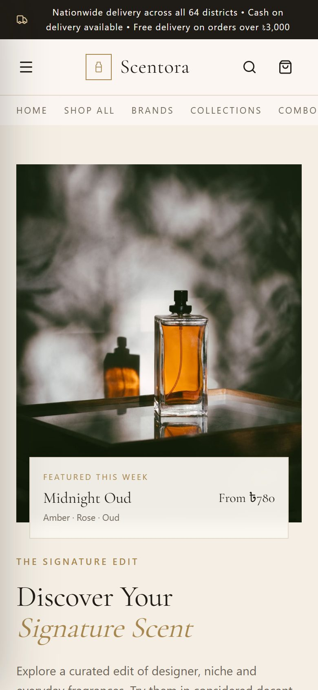
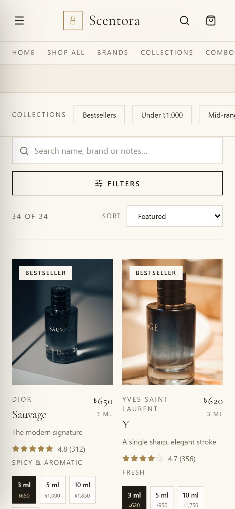
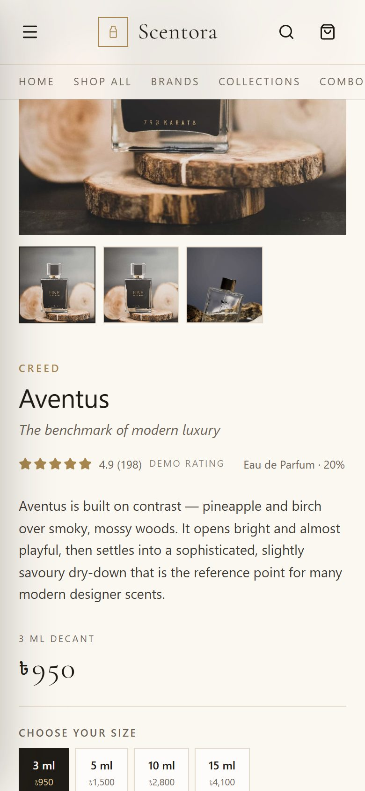

<div align="center">

# Scentora

### A premium fragrance e-commerce storefront — frontend only

**Live demo → [scentora.pages.dev](https://scentora.pages.dev)**

</div>

---

<div align="center">

[](https://nextjs.org)
[](https://react.dev)
[](https://www.typescriptlang.org)
[](https://tailwindcss.com)
[](https://www.framer.com/motion/)
[](https://pages.cloudflare.com)
[](#license)

</div>

<div align="center">

**[View the live site](https://scentora.pages.dev) · [Source code](#project-structure) · [Re-brand it in 5 minutes](#re-branding-for-a-new-client)**

</div>

---

## About

**Scentora** is a complete, production-quality demonstration storefront for a fragrance boutique —
the kind of site a decant or premium-perfume retailer would actually run. It ships with a
**34-fragrance catalogue**, a working shopping bag, live search and filtering, and a
five-step fragrance finder that scores products locally and explains every match.

**It is frontend only.** No backend, no database, no authentication, no payment gateway, no
external API. Everything runs in the browser against local TypeScript data and React state.

| | |
| --- | --- |
| **Demo site** | https://scentora.pages.dev |
| **Repository** | https://github.com/r-akib-77/scentora |
| **Framework** | Next.js 15 (App Router) · React 19 · TypeScript 5 |
| **Styling** | Tailwind CSS v4 with a runtime-driven design token system |
| **Animation** | Framer Motion 14 |
| **Icons** | Lucide React |
| **Build output** | Static export — deploys to any host, no server runtime |

---

## Screenshots

<div align="center">

### Home — editorial hero, category tiles and product discovery


### Product grid — decant size selector with live pricing on every card


### Collection — filter sidebar, sorting and active filter chips



### Product detail — gallery, notes pyramid and performance data



</div>

<div align="center">

### Fragrance finder — five questions, explained matches



### Bundles — curated sets priced below the sum of their parts



### Brand directory



### Mobile — fully responsive down to 360 px





</div>

---

## Features

### Catalogue & product pages
- **34 fragrances** with structured data: notes pyramid, scent family, gender, occasions, seasons, concentration, longevity and projection
- **Decant size selector** (3 / 5 / 10 / 15 ml) on every card, quick view and product page — not every fragrance stocks every size
- Selecting a size **updates the price everywhere** and the chosen variant is carried into the bag as its own line
- Product pages with image gallery, quantity stepper, note pyramid, shipping detail and related fragrances
- **Graceful image fallbacks** — a missing photo renders a branded placeholder, never a broken image

### Collection page
- Live search across name, brand, scent notes and tags
- Filters for **brand, gender, scent family, bottle size, price range and price bracket**
- Sort by featured, popularity, price (both directions) and name
- Active filter chips, product count, clear-all, and a considered empty state
- Responsive: a sticky sidebar on desktop, a slide-in filter drawer on mobile
- Filters are mirrored into the URL, so a filtered view can be shared or bookmarked

### Shopping bag
- Add to bag with the selected size and quantity, from card, quick view, product page or bundle
- Slide-in bag drawer with quantity steppers, removal, per-line totals and a running subtotal
- **Free-delivery progress bar** against the configured threshold
- Empty-bag state with a route back into the collection
- **Persisted to `localStorage`** — the bag survives a page refresh
- A clearly-labelled **demo checkout** that states it creates no order and takes no payment

### Fragrance finder
- Five questions: occasion, weather/season, preferred family, budget and preferred intensity
- Progress indicator, answer cards, back/next, required-answer validation
- **Transparent local scoring engine** (`src/lib/finder.ts`) — weighted scoring against catalogue tags, with a match percentage and the reasons behind every result
- Results link to the product page and can be added to the bag directly

### Editorial & trust
- Curated bundles that expand into their individual decants at normal pricing, with savings shown
- Brand directory across 25 houses, each linking to a filtered collection
- Trust sections, sample testimonials (labelled as sample copy), FAQ accordion and a newsletter form with a demo success state
- Full editorial fragrance guide with a glossary

### Craft
- **Design tokens driven from one config file** — the whole storefront re-themes from eight colour values
- Scroll reveals, hover states, drawer and modal transitions via Framer Motion
- Toast notifications, full keyboard support, visible focus rings
- `prefers-reduced-motion` respected globally
- Semantic HTML, skip link, labelled dialogs, `aria-pressed` / `aria-checked` on every toggle
- Custom 404 page, per-route SEO metadata, custom favicon
- No horizontal overflow from 360 px upward

---

## Quick start

```bash
git clone https://github.com/r-akib-77/scentora.git
cd scentora
npm install
npm run dev
```

Open <http://localhost:3000>.

**No environment variables are required.** The only build-time network access is Google Fonts
(for `next/font`), which is cached in `.next/cache` after the first build.

### Scripts

| Command | What it does |
| --- | --- |
| `npm run dev` | Development server on port 3000 |
| `npm run build` | Production build (standard Next.js server output) |
| `npm run build:static` | Regenerates image variants and emits a **fully static** site into `out/` |
| `npm run start` | Serves the production build |
| `npm run serve:static` | Serves the static export locally |
| `npm run lint` | ESLint |
| `npm run verify:assets` | Confirms every referenced image exists |
| `npm run verify:links` | Crawls the running site for broken internal links |
| `npm run test:interact` | 27-check browser test suite |

---

## Project structure

```
src/
├── app/                        # Routes (App Router)
│   ├── layout.tsx              # Fonts, providers, header, footer, overlays
│   ├── page.tsx                # Home
│   ├── shop/                   # Collection
│   ├── product/[slug]/         # Product detail
│   ├── brands/  combos/  fragrance-guide/  about/  contact/
│   ├── privacy/  shipping/  returns/
│   └── not-found.tsx
├── components/
│   ├── layout/                 # Header, announcement bar, mobile nav, search, footer
│   ├── product/                # Card, grid, size selector, gallery, quick view
│   ├── shop/                   # Filter sidebar, mobile drawer, collection view
│   ├── cart/                   # Bag drawer, bag line item
│   ├── finder/                 # Fragrance finder
│   ├── home/                   # Hero, categories, brands, bundles, testimonials, FAQ
│   ├── brands/  contact/  policy/  ui/
├── providers/                  # Cart, toast and UI (overlay) state
├── lib/                        # Filters, recommendation engine, formatting, scroll lock
├── config/site.ts              # ← the single brand configuration file
├── data/                       # The mock catalogue
└── types/                      # Shared TypeScript types

public/images/                  # Product, category, bundle and hero photography
scripts/                        # Optional QA + asset tooling (see scripts/README.md)
docs/                           # Screenshots used in this README
```

---

## Re-branding for a new client

Everything that identifies the brand lives in **one file**: `src/config/site.ts`.

### 1. Brand and palette

```ts
brand: {
  name: "Scentora",
  wordmark: "Scentora",
  tagline: "Fragrance, considered",
  colors: {
    ivory:   "#FBF7F1",   // page background
    paper:   "#F4EEE4",   // alternating sections
    beige:   "#E9DFCE",   // panels
    charcoal:"#1F1B16",   // body text
    muted:   "#6E6558",   // secondary text
    gold:    "#A8874F",   // accent
    goldSoft:"#DCC49A",   // light accent
    line:    "#E4DACB",   // hairlines
  },
}
```

Those eight values are injected as CSS custom properties at runtime, so changing them
re-skins the entire storefront — buttons, borders, focus rings, gradients and all. No
component edits required.

### 2. Commerce, contact and copy

`currency` (symbol, code, locale) · `announcement` · `contact` · `social` · `delivery` ·
`hero` · `sections` · `footer` · `trustPoints` · `newsletter`

### 3. The catalogue

`src/data/products.ts` holds the 34 fragrances. One record looks like this:

```ts
{
  id: "p-001",
  slug: "dior-sauvage",              // becomes /product/dior-sauvage
  brand: "Dior",
  name: "Sauvage",
  tagline: "The modern signature",
  description: "…",
  image: "/images/products/dior-sauvage.jpg",
  gallery: ["/images/products/dior-sauvage.jpg"],
  variants: [                        // only list the sizes you actually stock
    { size: 3,  price: 650 },
    { size: 5,  price: 1000 },
    { size: 10, price: 1850 },
    { size: 15, price: 2650 },
  ],
  notes: { top: ["Bergamot", "Pepper"], heart: ["Violet Leaf"], base: ["Ambrette"] },
  family: "spicy",
  familyLabel: "Aromatic Fougère",
  gender: "men",
  occasions: ["daily", "office", "date-night"],
  seasons: ["summer", "spring", "all-season"],
  tier: "premium",
  concentration: "Eau de Parfum",
  concentrationPercent: 18,
  featured: true,
  bestseller: true,
  rating: 4.8,                       // clearly labelled as demo data in the UI
  reviewCount: 312,
  longevity: 8,                      // illustrative
  projection: 5,                     // illustrative, 1–5
  tags: ["bergamot", "fougere", "pepper"],
  popularity: 98,
}
```

Drop the matching photo into `public/images/products/<slug>.jpg` and run
`npm run build:static` to regenerate the responsive variants. A missing photo falls back to a
branded placeholder, so the catalogue never shows a broken image.

### Other editable data files

| File | Contents |
| --- | --- |
| `src/data/brands.ts` | 25 fragrance houses (typographic wordmarks — no third-party logos) |
| `src/data/bundles.ts` | Curated bundles and the six category tiles |
| `src/data/content.ts` | Sample testimonials and FAQs |
| `src/data/guide.ts` | Fragrance-guide sections, glossary and the quiz definition |

---

## Architecture notes

- **State** — `CartProvider`, `ToastProvider` and `UIProvider` are React context providers
  mounted once in the root layout. No global state library, no duplicated business logic.
- **Server vs client** — pages are Server Components; only interactive pieces carry
  `"use client"`. `parseFiltersFromParams` lives in `src/lib/filters.ts` so the server page and
  the client view read the same filter shape.
- **Types** — every domain object (product, variant, bag line, filter state, quiz answer,
  recommendation) is typed in `src/types/index.ts`.
- **Fonts** — Cormorant Garamond (display), Inter (UI) and Noto Sans Bengali (the ৳ taka sign,
  which the Latin faces do not carry). All self-hosted by `next/font`.
- **Images** — a custom `next/image` loader serves pre-generated 320 / 640 / 960 / 1280 / 1920 px
  variants. There is no image optimiser, no server dependency and no third-party image host.
- **Accessibility** — semantic landmarks, skip link, visible focus rings, `aria-pressed` /
  `aria-checked` toggles, labelled dialogs, keyboard-dismissable overlays and a global
  `prefers-reduced-motion` fallback.
- **Performance** — static generation for every product page, transform/opacity-only
  animation, and a shared 103 kB JS baseline.

### Demo-content honesty

Ratings, review counts, testimonials, longevity figures, delivery promises and the checkout are
**clearly labelled as sample/demo content** in the interface. The checkout copy states
explicitly that no order is created and no payment is taken. Rewrite these to match what the
real business can claim before going live.

---

## Deployment

### Cloudflare Pages (what the demo uses)

```bash
npm run build:static
# then either connect the repo in Pages with:
#   build command  -> npm run build:static
#   output dir     -> out
# or upload directly with the bundled script:
node scripts/deploy-pages.mjs <project> out <upload-token-file>
```

### Any other static host

`npm run build:static` produces a plain `out/` directory — drop it on Netlify, Vercel, S3,
Cloudflare R2, GitHub Pages or any nginx box. There is no server runtime to configure.

### Standard Next.js server

`npm run build && npm start` works too, if the client prefers a Node deployment.

---

## Quality assurance

The `scripts/` folder contains the tooling used to build and verify this project.

```bash
node scripts/verify-assets.mjs                       # every referenced image exists
node scripts/verify-links.mjs https://scentora.pages.dev   # no broken internal links
node scripts/verify-images-live.mjs https://scentora.pages.dev
node scripts/interact.mjs https://scentora.pages.dev  # 27 functional browser checks
```

Current status against the live deployment:

- **27/27** functional browser checks passing
- **85/85** internal links resolving
- **56 images** loading across 15 routes, no 404s or 500s
- Production build clean — zero TypeScript errors, zero lint warnings

See [`scripts/README.md`](scripts/README.md) for the full list.

---

## License

MIT — use it, fork it, re-brand it, sell what you build with it.

## Credits

- Catalogue photography from [Pexels](https://www.pexels.com) under the Pexels licence. The
  photo ids used are recorded in `public/images/ATTRIBUTION.json`.
- Product names and houses are the trademarks of their respective owners and are used here
  only as **sample catalogue data** in a demonstration storefront.
- Icons by [Lucide](https://lucide.dev). Motion by [Framer Motion](https://www.framer.com/motion/).
